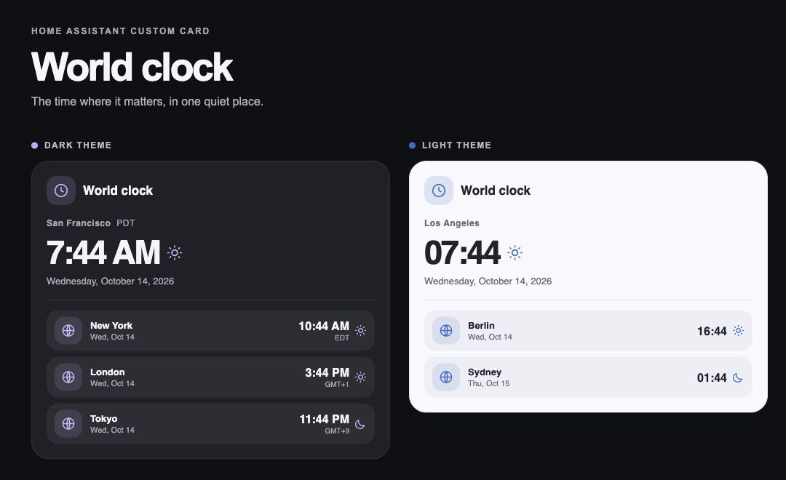

# World Clock Card

A compact, Material styled world clock for Home Assistant dashboards. Put a primary clock and up to eleven other places in one card. It follows your Home Assistant theme, adjusts to narrow screens, and handles daylight saving changes through the browser's IANA time zone data.



The screenshot is rendered from the included [demo](demo/index.html) with example cities. It contains no household data or private images.

## What it shows

- A large primary clock with the local date; the first `zones` entry is the primary clock.
- Smaller clocks with each place's own date, so “tomorrow” across the date line is visible.
- Optional day/night icons, time zone abbreviations, local images or Home Assistant entity pictures for every clock.
- Original comic style images for San Francisco, Stuttgart, and Lake Tahoe, bundled for HACS or manual installation.
- 12-hour, 24-hour, or locale-selected time; optional seconds.
- Automatic updates at each minute boundary, or each second when seconds are shown. The timer stops when the card leaves the page.
- Content-sized height in Home Assistant sections views, including when a title or many places are configured.

The card needs no sensors, API key, build step, CDN, or external service. Its time comes from the viewing device's clock. Optional remote `image` URLs are the only reason it would request content from another site.

## Install

### HACS custom repository

1. In HACS, open the three-dot menu and choose **Custom repositories**.
2. Add `https://github.com/otw/ha-worldclock-card` as a **Dashboard** repository and download it.
3. In **Settings → Dashboards → Resources**, add `/hacsfiles/ha-worldclock-card/ha-worldclock-card.js` as a **JavaScript module** if HACS has not added it automatically.
4. Add the [minimal card YAML](#minimal-example) to a dashboard and reload the browser.

The repository follows [HACS dashboard plugin structure](https://www.hacs.xyz/docs/publish/plugin/): its `dist/` JavaScript file matches the repository name, and the illustrations sit beside it.

### Manual

1. Copy [`ha-worldclock-card.js`](ha-worldclock-card.js) to `/config/www/ha-worldclock-card.js`. To use the bundled artwork, also copy the three `.webp` files in [`dist/`](dist/) to `/config/www/ha-worldclock-card/`.
2. Add `/local/ha-worldclock-card.js` under **Settings → Dashboards → Resources**, with type **JavaScript module**.
3. Add the [minimal card YAML](#minimal-example) and reload the browser.

After replacing a manually installed file, reload the dashboard. If the browser still shows the previous version, change the resource URL to `/local/ha-worldclock-card.js?v=2` (increment `v` for later updates).

## Minimal example

```yaml
type: custom:ha-worldclock-card
zones:
  - name: San Francisco
    timezone: America/Los_Angeles
  - name: Berlin
    timezone: Europe/Berlin
  - name: Tokyo
    timezone: Asia/Tokyo
```

Use [IANA time zone names](https://www.iana.org/time-zones), not fixed UTC offsets. That lets the browser account for daylight saving changes.

## Illustrated places

The included images are square, comic style illustrations with rounded corners in the card. The default rounded-square shape gives landmarks more room than a circle. Set `image_shape: circle` if you prefer round portraits. All three images are original artwork with no household data.

For a **HACS installation**, use:

```yaml
type: custom:ha-worldclock-card
zones:
  - name: San Francisco
    timezone: America/Los_Angeles
    image: /hacsfiles/ha-worldclock-card/san-francisco.webp
  - name: Stuttgart
    timezone: Europe/Berlin
    image: /hacsfiles/ha-worldclock-card/stuttgart.webp
  - name: Tahoe
    timezone: America/Los_Angeles
    image: /hacsfiles/ha-worldclock-card/tahoe.webp
```

For a **manual installation**, use `/local/ha-worldclock-card/san-francisco.webp` and the corresponding Stuttgart and Tahoe paths after copying the images as described above.

You can replace any `image` with your own `/local/...` path, `/hacsfiles/...` path, or HTTPS URL. A 1:1 image at least 128 × 128 pixels works well. With no image, a small clock uses a globe; the primary clock keeps its text layout. An `entity_id` with an `entity_picture` can also provide a dynamic image.

## Configuration

| Option | Default | Description |
| --- | --- | --- |
| `zones` | Required | List of 1–12 places. The first is the large primary clock. |
| `title` | Hidden | Optional card title. Set `World clock` for an Anker-style header. |
| `hour_format` | `auto` | `auto`, `12`, or `24`. `auto` follows the selected locale. |
| `locale` | Home Assistant language | BCP 47 locale such as `en-US` or `de-DE`. |
| `date_format` | `long` | Primary date: `long`, `short`, or `none`. |
| `show_secondary_date` | `true` | Show each smaller clock's local date. |
| `show_seconds` | `false` | Display seconds and update every second. |
| `show_time_zone` | `false` | Show abbreviations such as `PDT`; some zones display `GMT+2`. |
| `show_day_night` | `true` | Show a sun or moon based on each zone's local hour. |
| `day_start_hour` | `6` | First daytime hour, from `0` to `23`. |
| `day_end_hour` | `18` | First nighttime hour, from `0` to `23`. |
| `show_images` | `true` | Show configured images; otherwise use a globe icon. |
| `image_shape` | `rounded-square` | `rounded-square` or `circle` for all place images. |
| `layout` | `auto` | `auto` uses two columns when wide enough; `list` and `grid` override it. |

Each `zones` entry accepts:

| Field | Required | Description |
| --- | --- | --- |
| `name` | Yes | Label shown for that place. |
| `timezone` | Yes | Valid IANA time zone, such as `Europe/Berlin`. |
| `image` | No | Image URL or path for any place, including the primary clock. `cities/berlin.jpg` resolves to `/local/cities/berlin.jpg`. |
| `entity_id` | No | Entity whose `entity_picture` takes precedence over `image` when available. |

The day/night icons use the configured clock-hour range. They do not calculate astronomical sunrise or sunset.

### Complete example

```yaml
type: custom:ha-worldclock-card
title: World clock
hour_format: '24'
locale: en-GB
date_format: long
show_secondary_date: true
show_time_zone: true
show_day_night: true
day_start_hour: 7
day_end_hour: 19
layout: auto
zones:
  - name: Local time
    timezone: America/Los_Angeles
  - name: New York
    timezone: America/New_York
    image: cities/new-york.jpg
  - name: London
    timezone: Europe/London
  - name: Tokyo
    timezone: Asia/Tokyo
```

Place local images under `/config/www/`; the example image above would be `/config/www/cities/new-york.jpg`. Images are optional for every zone.

## Upgrade from an older `ha-worldclock-card`

The custom element name and `zones` YAML remain `ha-worldclock-card`, so existing dashboard configurations continue to load. Relative `image` paths and `entity_id` are supported. Replace the old JavaScript resource with this card's file, then refresh the browser. Keep only **one** `ha-worldclock-card.js` resource to avoid loading two implementations of the same element.

This version removes the original CDN dependencies and per-second console logging. It formats time directly in the requested time zone, including daylight saving transitions, and updates once per minute unless `show_seconds: true`.

## Troubleshooting

| Symptom | Check |
| --- | --- |
| “Custom element doesn't exist” | Confirm the resource URL, JavaScript module type, and browser reload. |
| Old appearance after updating | Change the manual resource URL's `v=` value, then reload. HACS users should reload after upgrading. |
| An incorrect time | Check the viewing device's clock and the zone's IANA name. |
| A missing picture | Check its `/config/www/` path or the configured entity's `entity_picture`. The clock works without pictures. |
| Unexpected `GMT+...` label | Your browser has no short abbreviation for that zone. Set `show_time_zone: false` to hide it. |

## Development

Run `node --test tests/card.test.cjs` for configuration, daylight saving, date, image path, and update-boundary tests. For a local visual preview, run `python3 -m http.server` at the repository root and open `/demo/`. The demo has no Home Assistant connection and uses only example cities.

## Releases

Milestones use Git tags and GitHub Releases named `vMAJOR.MINOR.PATCH`. Changes are recorded in [CHANGELOG.md](CHANGELOG.md). During `0.x`, a minor release may change configuration; patch releases fix behavior without intentionally changing it.

## License

MIT. See [LICENSE](LICENSE).
